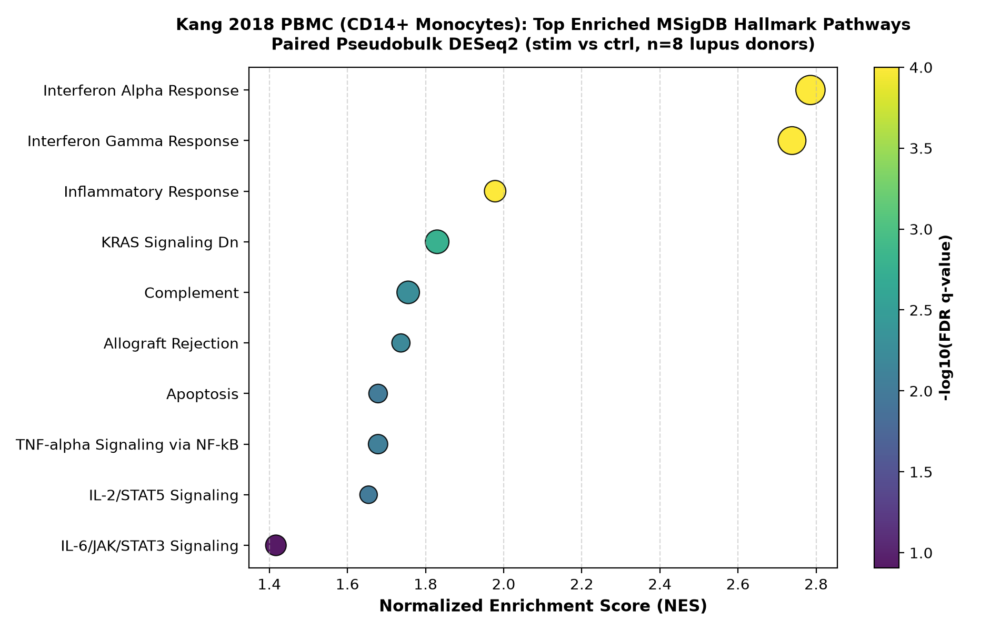
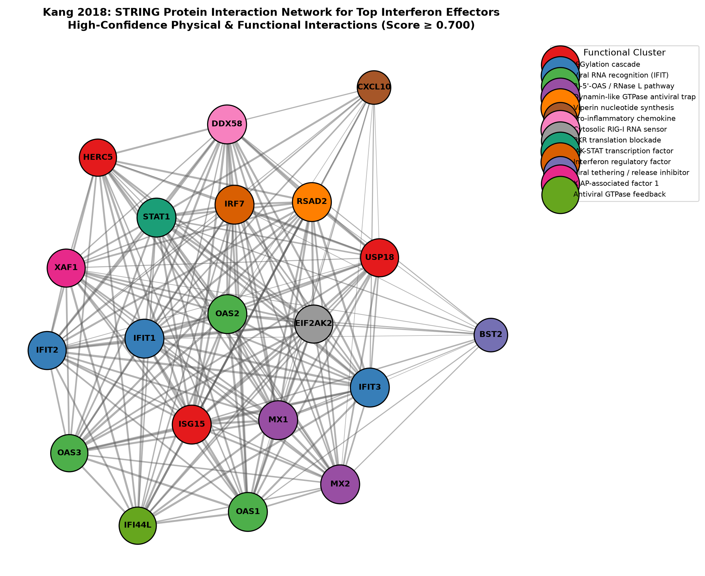
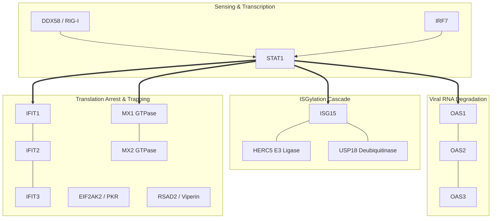

# Kang et al. (2018) PBMC Interferon-Beta Response: Donor-Paired Pseudobulk, GSEA & STRING Network

This study provides an end-to-end, reproducible computational investigation of the cell-type-specific transcriptional response to interferon-beta ($\text{IFN-}\beta$) across human peripheral blood mononuclear cells (PBMCs), using the multiplexed droplet single-cell RNA-seq cohort from **Kang et al. (2018)** (*Nature Biotechnology* 36, 89–94).

---

## 1. Study Overview & Biological Problem

Type I interferons ($\text{IFN-}\alpha/\beta$) orchestrate the innate antiviral response by inducing hundreds of interferon-stimulated genes (ISGs). In autoimmune conditions such as systemic lupus erythematosus (SLE), an aberrant, persistent interferon signature is a hallmark of immunopathology.

Understanding how distinct immune subsets (myeloid cells vs. lymphoid lineages) modulate their transcriptional programs in response to $\text{IFN-}\beta$ requires:
1. **Controlling for inter-individual baseline variation:** Healthy and patient donors exhibit heterogeneous baseline expression; evaluating treatment response without pairing conflates donor identity with stimulation effect.
2. **Eliminating single-cell pseudo-replication:** Treating individual cells as independent observations inflates false discovery rates by several orders of magnitude. Aggregating single cells into **donor-paired pseudobulk counts** provides proper biological replicates for generalized linear models (DESeq2 / edgeR).

---

## 2. Cohort & Data Provenance

| Parameter | Specification |
| :--- | :--- |
| **Primary Reference** | Kang et al. *Multiplexed droplet single-cell RNA-sequencing using natural genetic variation.* Nature Biotech 36, 89–94 (2018). |
| **NCBI GEO Accession** | [GSE96583](https://www.ncbi.nlm.nih.gov/geo/query/acc.cgi?acc=GSE96583) |
| **Bioconductor Hub** | `muscData::Kang18_8vs8()` / `ExperimentHub::EH2259` |
| **Cohort Composition** | 8 SLE patient donors, each with matched unstimulated control (`ctrl`) and 6-hour recombinant IFN-$\beta$ stimulated (`stim`) aliquots. |
| **Total Cells & Features** | 29,065 cells (24,679 singlets after doublet/ambiguity filtering) across 35,635 genomic features. |
| **Sequencing Platform** | 10x Genomics Chromium 3' droplet sequencing. |

---

## 3. Donor-Paired Pseudobulk Modeling

For each cell type, single-cell raw UMI counts are summed across all singlets belonging to each donor-condition stratum:

$$Y_{g, d, c} = \sum_{i \in \text{donor } d, \text{ cond } c} C_{g, i}$$

Only donors with complete pairs meeting minimum cell counts ($\ge 20$ cells in both `ctrl` and `stim`) are retained. The differential expression model accounts for donor-specific baselines:

$$\log(\mu_{g, d, c}) = \alpha_g + \beta_{g, d}^{\text{donor}} + \gamma_g \cdot \mathbb{I}(\text{stim})$$

Statistical inference uses negative binomial dispersion estimation, Wald tests, and Benjamini-Hochberg false-discovery rate (FDR) adjustment ($\alpha = 0.05$).

### Cross-Cell-Type Response Summary

| PBMC Lineage | Complete Donor Pairs | Genes Tested | Significant DEGs ($p_{\text{adj}} < 0.05$, $|\log_2\text{FC}| \ge 1$) | Up / Down | $\text{ISG15 } \log_2\text{FC}$ | $\text{IFIT1 } \log_2\text{FC}$ | $\text{MX1 } \log_2\text{FC}$ | $\text{OAS1 } \log_2\text{FC}$ |
| :--- | :---: | :---: | :---: | :---: | :---: | :---: | :---: | :---: |
| **CD14+ Monocytes** | 8 | 5,304 | **1,586** | 905 / 681 | +7.29 | +8.05 | +5.80 | +4.89 |
| **FCGR3A+ Monocytes** | 8 | 3,186 | **705** | 486 / 219 | +6.11 | +6.65 | +4.72 | +2.66 |
| **CD4 T cells** | 8 | 6,885 | **446** | 343 / 103 | +4.92 | +6.66 | +4.78 | +5.05 |
| **B cells** | 8 | 3,721 | **405** | 314 / 91 | +5.56 | +6.53 | +4.89 | +4.52 |
| **Dendritic cells** | 5 | 1,679 | **349** | 269 / 80 | +6.43 | +8.43 | +5.68 | +5.56 |
| **NK cells** | 7 | 2,686 | **251** | 207 / 44 | +4.69 | +6.13 | +4.24 | +4.32 |
| **CD8 T cells** | 7 | 2,707 | **159** | 147 / 12 | +4.76 | +5.58 | +5.13 | +4.88 |

**Key Finding:** Myeloid cells (CD14+ and FCGR3A+ monocytes) exhibit the highest transcriptional dynamic range and largest DEG counts (over 1,500 in CD14+ monocytes), driving massive chemokine induction (*CXCL10*, *CXCL11*, *CCL8*). In contrast, lymphoid subsets (CD4/CD8 T cells, NK cells) maintain a more targeted antiviral program focused primarily on viral sensing and translation arrest.

---

## 4. MSigDB Hallmark Pathway Enrichment (GSEA)

Pre-ranked Gene Set Enrichment Analysis (GSEA) was performed on the Wald statistics from the paired DESeq2 model in CD14+ Monocytes against the **MSigDB Hallmark Gene Sets (2020)**.



### Top Enriched Hallmark Pathways

| Pathway Term | Enrichment Score (ES) | Normalized Enrichment Score (NES) | Nominal $p$-value | FDR $q$-value | Leading Edge Genes (Sample) |
| :--- | :---: | :---: | :---: | :---: | :--- |
| **Interferon Alpha Response** | 0.862 | **+2.79** | $< 0.001$ | **$0.000$** | *IFITM2*, *ISG20*, *IRF7*, *EIF2AK2*, *CXCL11*, *ISG15*, *OAS1*, *MX1*, *RSAD2* |
| **Interferon Gamma Response** | 0.805 | **+2.74** | $< 0.001$ | **$0.000$** | *DDX58*, *STAT1*, *STAT2*, *XAF1*, *OAS2*, *OAS3*, *IFIT1*, *IFIT2*, *IFIT3* |
| **Inflammatory Response** | 0.591 | **+1.98** | $< 0.001$ | **$0.000$** | *IRF7*, *CXCL11*, *BST2*, *CD40*, *TNFSF10*, *CXCL10*, *CCL2*, *CCL7*, *IL15* |
| **KRAS Signaling Down** | 0.740 | **+1.83** | $< 0.001$ | $0.0017$ | *MX1*, *RSAD2*, *CD80*, *IFI44L*, *SGK1*, *MEFV* |
| **Complement** | 0.538 | **+1.76** | $< 0.001$ | $0.0053$ | *PLSCR1*, *SERPING1*, *CASP1*, *CASP4*, *JAK2*, *CTSS*, *CD59*, *SERPINA1* |
| **Allograft Rejection** | 0.527 | **+1.74** | $< 0.001$ | $0.0064$ | *IRF7*, *SOCS1*, *STAT1*, *B2M*, *JAK2*, *CD80*, *GBP2*, *ITGB2*, *PRF1* |
| **Apoptosis** | 0.521 | **+1.68** | $< 0.001$ | $0.0098$ | *ISG20*, *CD38*, *TNFSF10*, *CASP1*, *CASP8*, *PMAIP1*, *BIRC3*, *XIAP* |
| **TNF-$\alpha$ Signaling via NF-$\kappa$B** | 0.505 | **+1.68** | $< 0.001$ | $0.0085$ | *DDX58*, *IFIH1*, *CXCL11*, *CXCL10*, *IL15RA*, *RIPK2*, *CCL2*, *TNFAIP2* |

---

## 5. STRING High-Confidence Effector Interaction Network

To elucidate physical complexes and functional cascades mediating antiviral resistance, top stimulated effectors were mapped to the **STRING Database (v12.0)** for *Homo sapiens* (taxid 9606) at high confidence (combined interaction score $\ge 0.700$).

The resulting network comprises **20 core nodes** interconnected by **179 high-confidence interaction edges**.



### Functional Effector Clusters



1. **ISGylation Cascade:** *ISG15* acts as a central hub (highest degree), regulated by the isopeptidase *USP18* (confidence 0.999) and the E3 ubiquitin ligase *HERC5* (confidence 0.999).
2. **Viral RNA Recognition (IFIT Complex):** *IFIT1*, *IFIT2*, and *IFIT3* form a tightly bound tripartite complex (confidence 0.999) that binds non-self 5'-triphosphate or 2'-O-unmethylated viral RNA to inhibit translation.
3. **2'-5'-Oligoadenylate Synthetase (OAS) Pathway:** *OAS1*, *OAS2*, and *OAS3* synthesize 2'-5' oligoadenylates upon dsRNA binding to activate endoribonuclease L (*RNASEL*).
4. **Dynamin-like GTPase Antiviral Traps:** *MX1* and *MX2* oligomerize around viral nucleocapsids, preventing cytoplasmic uncoating and nuclear import.
5. **Chemokine Signal Amplification:** *CXCL10* promotes effector lymphocyte recruitment to infected sites.

---

## 6. Reproducibility, Manifest & Available Outputs

All code, configuration parameters, and precomputed benchmark outputs are fully versioned in the repository.

### Machine-Readable Study Manifest (`study_manifest.json`)

To ensure end-to-end provenance and computational reproducibility across heterogeneous environments, a machine-readable JSON manifest is versioned at [`results/study_manifest.json`](results/study_manifest.json) (mirrored to `results/manifest.json`).

| Manifest Block | Recorded Metadata & Specifications |
| :--- | :--- |
| **Study & Accession** | Primary NCBI GEO accession **GSE96583**, Bioconductor ExperimentHub resource **EH2259** (`muscData::Kang18_8vs8`), organism (*Homo sapiens*, taxid 9606), 10x Chromium 3' platform, and primary citation (Kang et al. *Nat Biotech* 2018; PMID 29227470). |
| **Cohort Definition** | 8 SLE patient donors (IDs: 101, 1015, 1016, 1039, 107, 1244, 1256, 1488), paired 6h recombinant IFN-$\beta$ (100 U/mL) vs. control, 24,679 filtered singlets, 35,635 genomic features across 7 lineages. |
| **Package Versions** | Python environment (`scanpy >= 1.10`, `anndata >= 0.10`, `pydeseq2 0.4.11`, `gseapy 1.1.4`, `pandas`, `numpy`, `scipy`, `matplotlib`, `networkx`); R / Bioconductor environment (`R >= 4.3.0`, `DESeq2 >= 1.40.0`, `SingleCellExperiment`, `SummarizedExperiment`, `muscData`, `ExperimentHub`, `clusterProfiler`, `msigdbr`); External APIs (STRING Database API v12.0, MSigDB Hallmark 2020). |
| **Analysis Parameters** | Pseudobulk sum aggregation, min 20 cells/donor/condition, min 3 complete pairs; Paired GLM (`~ donor + condition`), Wald test, Benjamini-Hochberg FDR $\alpha = 0.05$, $|\log_2\text{FC}| \ge 1.0$, gene filter $\ge 10$ counts in $\ge 3$ samples; Pre-ranked GSEA (weight $p=1.0$, size [15, 500], 1,000 permutations); STRING interaction score threshold $\ge 0.700$ (high confidence). |
| **Random Seeds** | Explicit fixed RNG seeds (`42`) across Python `random`, NumPy `np.random`, GSEA permutation sampling, NetworkX graph layout, and test harness fixtures. |
| **Output Artifacts** | Cryptographic SHA-256 hashes, file sizes, MIME formats, and functional descriptions for all 16 generated benchmark artifacts. |

### Available Precomputed Benchmark Outputs

- **Machine-Readable Manifest:** [`results/study_manifest.json`](results/study_manifest.json)
- **Interactive HTML Report:** [`results/kang_interferon_report.html`](results/kang_interferon_report.html) (self-contained document with embedded high-resolution figures and metadata tables).
- **DESeq2 Results per Cell Type:** [`results/deseq2_*.csv`](results/)
- **Cross-Lineage Comparison:** [`results/celltype_response_summary.csv`](results/celltype_response_summary.csv)
- **GSEA Hallmark Results:** [`results/hallmark_gsea_results.csv`](results/hallmark_gsea_results.csv)
- **STRING Network Data:** [`results/string_network_edges.csv`](results/string_network_edges.csv) and [`results/string_network_nodes.csv`](results/string_network_nodes.csv)
- **Visualizations:** [`results/gsea_hallmark_dotplot.png`](results/gsea_hallmark_dotplot.png), [`results/gsea_hallmark_dotplot.svg`](results/gsea_hallmark_dotplot.svg), [`results/string_network.png`](results/string_network.png), [`results/string_network.svg`](results/string_network.svg)

### One-command full rerun from the downloaded study data

The complete runner rebuilds donor-paired pseudobulk tables and DESeq2 results for every eligible cell type, the cross-cell-type summary, Hallmark GSEA tables and plots, the STRING interaction tables and network figures, the self-contained HTML report, and a fresh manifest with hashes. The first run fetches `muscData::Kang18_8vs8()` through Bioconductor and saves a local RDS cache at `studies/kang_ifnb/data/Kang18_8vs8.rds`; later runs reuse that cache. STRING and MSigDB are external resources, so their current responses/versions are recorded rather than claimed to be immutable.

Install the R prerequisites once in R 4.3+:

```bash
Rscript -e 'install.packages(c("BiocManager", "jsonlite", "digest", "base64enc", "msigdbr")); BiocManager::install(c("SummarizedExperiment", "SingleCellExperiment", "ExperimentHub", "muscData", "DESeq2", "clusterProfiler"), ask = FALSE, update = FALSE)'
```

From the repository root, rerun the full analysis with one command:

```bash
Rscript studies/kang_ifnb/run_study.R
```

To explicitly refresh the downloaded input, use `Rscript studies/kang_ifnb/run_study.R --refresh-data`. To keep generated files elsewhere, use `--output-dir PATH`; to store the downloaded dataset cache elsewhere, use `--cache-dir PATH`. Use `--help` for the options. This runner needs internet access for the first data fetch and the STRING API request; it saves the exact raw STRING response beside the network outputs. It does not use the precomputed result CSVs as analysis inputs.

### Running Verification & Manifest Tests

```bash
# Verify study manifest structure and SHA-256 artifact checksums
python studies/kang_ifnb/run_pipeline.py --verify-manifest

# Run complete Python pytest suite (including manifest schema & tamper detection)
pytest -v

# Run R test suite (pseudobulk, DESeq2 modeling, GSEA, STRING network)
Rscript studies/kang_ifnb/test_pseudobulk.R
Rscript studies/kang_ifnb/test_deseq2.R
Rscript studies/kang_ifnb/test_pathway_enrichment.R
Rscript studies/kang_ifnb/test_string_network.R
```
